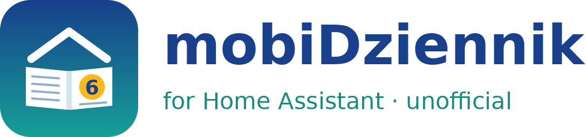

<p align="center">
  
</p>

# mobiDziennik for Home Assistant (unofficial)

A custom [Home Assistant](https://www.home-assistant.io/) integration that brings data from the Polish school e-register **mobiDziennik** into Home Assistant: timetable (with substitutions and days off), grades and averages, announced tests, homework and unread messages. It supports parent accounts with several children.

> [!IMPORTANT]
> This project is **not affiliated with, endorsed by or connected to Wizja.net**, the company behind mobiDziennik. mobiDziennik has no public API, so this integration reads the regular parent web portal, the same pages you see in a browser. It may stop working whenever the website changes.

## Features

One device is created per student, plus one for the parent account.

| Entity | Example state | Attributes |
|---|---|---|
| Next lesson | `matematyka (09:50)` | date, time, room, teacher, class, substitution |
| Today's lessons | `08:00–14:45 (7)` | list of lessons, substitutions, day off reason |
| Next school day | `Thu 12.11: 08:00–15:20 (8)` | same as above |
| Latest grade | `4+ – biologia` | category, topic, weight, teacher, entered |
| Grades (last 7 days) | `5` | readable list of recent grades |
| Average grade | `4.64` | per-subject weighted averages *(only when the school publishes averages)* |
| Next test | `Thu 12.11 język angielski (sprawdzian)` | days until, topic, list of upcoming tests |
| Homework | `2` (open items) | due date, subject, full content, done flag |
| Unread messages *(account)* | `4` | sender, date and subject of unread messages |

Time-dependent states (next lesson, today) are re-evaluated every minute locally, without contacting the website.

## Being a good citizen

Because this scrapes a website that does not offer an API, the integration deliberately keeps its footprint small:

* **Irregular, infrequent polling.** It polls every 45–75 minutes (randomised every cycle) on school days between 06:00 and 21:00, and every 2.5–3.5 hours at night and at weekends.
* **No bursts.** It waits a random 1–4 s between page loads within one refresh.
* **Minimal requests.** Next week's timetable is only fetched when the current week has no lessons left, and homework details are fetched once per assignment and then cached.
* **Strictly read-only.** It never opens individual messages, so they are not marked as read, and it never changes homework status.

Please do not shorten these intervals.

## Installation

### HACS (custom repository)

1. In HACS, open **⋮ → Custom repositories**.
2. Add `https://github.com/formiification/ha-mobidziennik` with the category **Integration**.
3. Install **mobiDziennik (unofficial)** and restart Home Assistant.

### Manual

Copy `custom_components/mobidziennik` into your `<config>/custom_components/` directory and restart Home Assistant.

## Configuration

Go to **Settings → Devices & services → Add integration → mobiDziennik (unofficial)** and enter:

* **School subdomain**: the part before `.mobidziennik.pl`. For example, for `https://myschool.mobidziennik.pl` enter `myschool`.
* **Login / e-mail** and **password**: your parent account credentials.

Credentials are stored in Home Assistant's config entry, like in any other integration, and are only sent to your school's mobiDziennik address.

## Dashboard example

A simple per-child card using built-in cards only:

```yaml
type: vertical-stack
cards:
  - type: grid
    columns: 2
    square: false
    cards:
      - type: tile
        entity: sensor.kowalski_jan_next_lesson
      - type: tile
        entity: sensor.kowalski_jan_today_lessons
      - type: tile
        entity: sensor.kowalski_jan_next_test
      - type: tile
        entity: sensor.kowalski_jan_homework
  - type: markdown
    content: >-
      **Today** — {{ states('sensor.kowalski_jan_today_lessons') }}
      
      - {{ l }}
      
```

Entity IDs are derived from the student's name as shown in mobiDziennik (`Kowalski Jan` → `sensor.kowalski_jan_*`).

## Limitations

* It was tested with a primary school using both descriptive (early years) and numeric grades. Other schools may use page variants that are not handled yet. Issues with an **anonymised** HTML snippet are welcome.
* Only the first page of the inbox (the 20 most recent messages) is checked for unread messages.
* Attendance and behaviour notes are not supported yet.

## Troubleshooting

Enable debug logging:

```yaml
logger:
  logs:
    custom_components.mobidziennik: debug
```

When reporting a problem, **remove names, logins and other personal data** from logs and HTML samples.

## License

[MIT](LICENSE)
