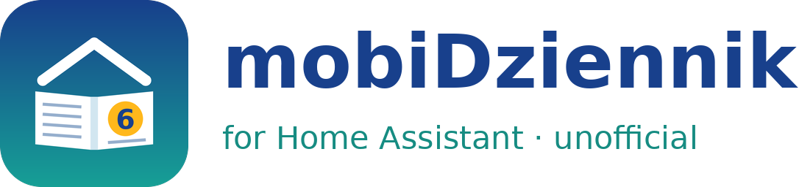

<p align="center">
  
</p>

# mobiDziennik dla Home Assistant (nieoficjalna integracja)

[](https://github.com/formiification/ha-mobidziennik/actions/workflows/validate.yml)
[](LICENSE)

🇬🇧 [English version](README.md)

Integracja [Home Assistant](https://www.home-assistant.io/), która przenosi do Home Assistant dane z e-dziennika **mobiDziennik**: plan lekcji (z zastępstwami i dniami wolnymi), oceny i średnie, zapowiedziane sprawdziany, zadania domowe, frekwencję, uwagi, kalendarz klasowy i nieprzeczytane wiadomości. Obsługuje konta rodzica z kilkorgiem dzieci.

> [!IMPORTANT]
> Ten projekt **nie jest powiązany z firmą Wizja.net**, twórcą mobiDziennika, ani przez nią wspierany. mobiDziennik nie ma publicznego API, więc integracja czyta zwykły portal dla rodziców, czyli te same strony, które widzisz w przeglądarce. Może przestać działać po każdej zmianie strony.

## Funkcje

Dla każdego ucznia tworzone jest osobne urządzenie, a dodatkowo jedno dla konta rodzica.

| Encja | Przykładowy stan | Atrybuty |
|---|---|---|
| Następna lekcja | `matematyka (09:50)` | data, godzina, sala, nauczyciel, klasa, zastępstwo |
| Lekcje dzisiaj | `08:00–14:45 (7)` | lista lekcji, zastępstwa, powód dnia wolnego |
| Następny dzień szkolny | `czw. 12.11: 08:00–15:20 (8)` | jak wyżej |
| Ostatnia ocena | `4+ – biologia` | kategoria, temat, waga, nauczyciel, data wpisu |
| Oceny (ostatnie 7 dni) | `5` | czytelna lista ostatnich ocen |
| Średnia ocen | `4.64` | średnie ważone z przedmiotów *(tylko gdy szkoła publikuje średnie)* |
| Najbliższy sprawdzian | `czw. 12.11 język angielski (sprawdzian)` | liczba dni, temat, lista zapowiedzianych sprawdzianów |
| Zadania domowe | `2` (otwarte) | termin, przedmiot, pełna treść, czy zrobione |
| Frekwencja | `97.1` % | obecności, nieobecności usprawiedliwione i nieusprawiedliwione, spóźnienia, zwolnienia, ostatnie dni nieobecności |
| Nieusprawiedliwione nieobecności | `4` (lekcje) | dni z nieusprawiedliwionymi nieobecnościami, najstarszy z nich |
| Punkty z zachowania | `68` | ocena z zachowania, okres, oceny przewidywane i końcowe *(tylko w szkołach z punktowym systemem oceniania)* |
| Ostatnia uwaga | `+10 konkurs plastyczny` | rodzaj, kategoria, nauczyciel, data wpisu, liczba uwag pozytywnych, negatywnych i neutralnych, 10 ostatnich uwag |
| Kalendarz klasowy *(encja kalendarza)* | najbliższy wpis | zapowiedzi sprawdzianów i kartkówek, wydarzenia klasowe, wycieczki, rzeczy do przyniesienia, dni wolne |
| Nieprzeczytane wiadomości *(konto)* | `4` | nadawca, data i temat nieprzeczytanych wiadomości |

Teksty tworzone przez integrację (dni tygodnia, „Brak lekcji”, „Dzień wolny”, etykiety w kalendarzu) są po polsku, gdy Home Assistant działa po polsku, a w innym przypadku po angielsku.

Stany zależne od czasu (następna lekcja, dzisiaj) są przeliczane co minutę lokalnie, bez łączenia się ze stroną.

## Kulturalne korzystanie ze strony

Integracja czyta stronę, która nie oferuje API, więc celowo ogranicza obciążenie:

* **Rzadkie i nieregularne odpytywanie.** W dni szkolne w godz. 6:00–21:00 co 45–75 minut (losowo za każdym razem), w nocy i w weekendy co 2,5–3,5 godziny.
* **Bez serii zapytań.** Między kolejnymi stronami w jednym odświeżeniu czeka losowo 1–4 s.
* **Minimum zapytań.** Plan na kolejny tydzień pobiera dopiero wtedy, gdy w bieżącym nie ma już lekcji. Treść zadania domowego pobiera raz i zapamiętuje. Frekwencja, zachowanie i kalendarz klasowy zmieniają się rzadko, więc pobiera je najwyżej co 4 godziny.
* **Tylko odczyt.** Nigdy nie otwiera wiadomości (nie zostaną oznaczone jako przeczytane), nie zmienia statusu zadań domowych i nie wysyła usprawiedliwień.

Prosimy nie skracać tych odstępów.

## Instalacja

### Marketplace (jedno kliknięcie)

[](https://my.home-assistant.io/redirect/marketplace_repository/?owner=formiification&repository=ha-mobidziennik&category=integration)

Przycisk otwiera to repozytorium w **Ustawienia → Marketplace** (Home Assistant 2026.11 i nowszy) i proponuje jego dodanie. Kliknij **Pobierz**, a potem uruchom Home Assistant ponownie.

<details>
<summary>Ręcznie albo przez HACS w Home Assistant starszym niż 2026.11</summary>

1. Otwórz **Marketplace** (albo **HACS**) → **⋮ → Własne repozytoria**.
2. Dodaj `https://github.com/formiification/ha-mobidziennik` z kategorią **Integracja**.
3. Pobierz **mobiDziennik (unofficial)** i uruchom Home Assistant ponownie.

</details>

### Ręcznie

Skopiuj katalog `custom_components/mobidziennik` do `<config>/custom_components/` i uruchom Home Assistant ponownie.

## Konfiguracja

[](https://my.home-assistant.io/redirect/config_flow_start/?domain=mobidziennik)

Kliknij przycisk (po instalacji i ponownym uruchomieniu) albo wejdź w **Ustawienia → Urządzenia oraz usługi → Dodaj integrację → mobiDziennik (unofficial)** i podaj:

* **Subdomenę szkoły**: część adresu przed `.mobidziennik.pl`. Na przykład dla `https://mojaszkola.mobidziennik.pl` wpisz `mojaszkola`.
* **Login / e-mail** i **hasło**: dane logowania do konta rodzica.

Dane logowania są zapisane we wpisie konfiguracyjnym Home Assistant, tak jak w każdej innej integracji, i wysyłane wyłącznie na adres mobiDziennika Twojej szkoły.

## Przykłady kart na dashboard

Nie musisz znać YAML. Każdy przykład to gotowa karta do wklejenia.

### Krok 1: znajdź prefiks encji dziecka

Wszystkie encje jednego ucznia zaczynają się od tego samego prefiksu, utworzonego z imienia i nazwiska w mobiDzienniku. Na przykład **Kowalski Jan** daje `sensor.kowalski_jan_…`.

Identyfikatory encji są **zawsze po angielsku** (np. `…_next_lesson`), także gdy Home Assistant działa po polsku, więc poniższe przykłady działają bez zmian poza prefiksem.

Aby sprawdzić swój prefiks, otwórz **Ustawienia → Urządzenia oraz usługi → Encje**, wpisz w wyszukiwarkę `next_lesson` i spójrz na identyfikator encji, np. `sensor.nowak_zofia_next_lesson`. Prefiks to wszystko przed `next_lesson`, tutaj `nowak_zofia`.

### Krok 2: dodaj kartę

1. Otwórz dashboard i kliknij **✏️ Edytuj dashboard**. Jeśli Home Assistant zapyta, wybierz **Przejmij kontrolę**.
2. Kliknij **+ Dodaj kartę**, przewiń w dół i wybierz **Ręcznie**.
3. Usuń zawartość edytora, wklej jeden z przykładów i **zamień każde `kowalski_jan` na swój prefiks**. W większości edytorów *Ctrl + H* (znajdź i zamień) zrobi to za jednym razem.
4. Kliknij **Zapisz**.

Przykłady używają tylko kart wbudowanych w Home Assistant, więc nie trzeba niczego doinstalowywać.

---

### 1. Najważniejsze w skrócie

Sześć kafelków z najważniejszymi informacjami. Dotknij kafelka, żeby zobaczyć szczegóły.

```yaml
type: grid
columns: 2
square: false
cards:
  - type: tile
    entity: sensor.kowalski_jan_next_lesson
    name: Następna lekcja
  - type: tile
    entity: sensor.kowalski_jan_today_lessons
    name: Dzisiaj
  - type: tile
    entity: sensor.kowalski_jan_next_test
    name: Najbliższy sprawdzian
  - type: tile
    entity: sensor.kowalski_jan_homework
    name: Zadania domowe
  - type: tile
    entity: sensor.kowalski_jan_latest_grade
    name: Ostatnia ocena
  - type: tile
    entity: sensor.kowalski_jan_grades_last_7_days
    name: Oceny w tym tygodniu
```

> Jeśli szkoła publikuje średnie, ostatni kafelek możesz zamienić na `sensor.kowalski_jan_average_grade`.

### 2. Lekcje dziś i w następnym dniu szkolnym

Czytelny plan lekcji z salami. Zastępstwa są oznaczone ⚠️, a dni wolne pokazane z powodem.

```yaml
type: markdown
title: Lekcje
content: |-
  
  
  
  
  **{{ label }} · {{ dni[as_datetime(a.date).weekday()] }} {{ as_datetime(a.date).strftime('%d.%m') }}** — {{ 'dzień wolny: ' ~ a.day_off if a.day_off else (a.start ~ '–' ~ a.end if a.lesson_count else 'brak lekcji') }}
  
  - {{ l | replace('zastępstwo', '⚠️ zastępstwo') }}
  
  
  {{ day('sensor.' ~ p ~ '_today_lessons', 'Dzisiaj') }}

  {{ day('sensor.' ~ p ~ '_next_school_day', 'Następny dzień szkolny') }}
```

> Tutaj prefiks występuje tylko raz, w pierwszej linii (`set p = 'kowalski_jan'`).

### 3. Sprawdziany i zadania domowe

Wszystkie zapowiedziane sprawdziany z tematami i zadania domowe z pełną treścią. Zadania oznaczone jako zrobione są przekreślone.

```yaml
type: markdown
title: Sprawdziany i zadania
content: |-
  
  
  
  **📝 Zapowiedziane sprawdziany** ({{ t | count }})
  
  - {{ x }}
  
  - brak zapowiedzi
  


  **📚 Zadania domowe** (otwarte: {{ states('sensor.' ~ p ~ '_homework') }})
  
  - {{ ('~~' ~ x[2:] ~ '~~') if x.startswith('✔') else x }}
  
  - nic nie zadano
  
```

### 4. Oceny: co nowego w tym tygodniu

Każda ocena jest na początku, pogrubiona, a po niej przedmiot, data, kategoria, waga i temat.

```yaml
type: markdown
title: Oceny
content: |-
  
  **Ostatnie 7 dni** ({{ states('sensor.' ~ p ~ '_grades_last_7_days') }})
  
  - {{ g | regex_replace('^(\\d\\d\\.\\d\\d) ([^:]+): (\\S+)', '**\\3** · \\2 · \\1') }}
  
  - brak nowych ocen
  
```

### 5. Średnie z przedmiotów ze „światłami”

Tylko w szkołach, które publikują średnie (zwykle od 4 klasy). 🟢 oznacza 4,5 i więcej, 🟡 3,5–4,49, a 🔴 poniżej 3,5. Progi możesz zmienić.

```yaml
type: markdown
title: Średnie
content: |-
  
  
  **Ogółem: {{ '%.2f' | format(states(avg) | float(0)) }}**

  | Przedmiot | Średnia |
  |:--|--:|
  
  | {{ s }} | {{ '🔴' if v < 3.5 else ('🟡' if v < 4.5 else '🟢') }} {{ '%.2f' | format(v) }} |
  
```

### 6. Frekwencja i uwagi

Kafelki frekwencji i ostatniej uwagi, a pod nimi lista: nieobecności do usprawiedliwienia, ostatnie nieobecności i ostatnie uwagi. Kafelek „Punkty z zachowania” zadziała tylko w szkołach z punktowym systemem oceniania zachowania; w pozostałych usuń go.

```yaml
type: vertical-stack
cards:
  - type: grid
    columns: 2
    square: false
    cards:
      - type: tile
        entity: sensor.kowalski_jan_attendance
        name: Frekwencja
      - type: tile
        entity: sensor.kowalski_jan_unexcused_absences
        name: Nieusprawiedliwione
      - type: tile
        entity: sensor.kowalski_jan_behaviour_points
        name: Punkty z zachowania
      - type: tile
        entity: sensor.kowalski_jan_latest_remark
        name: Ostatnia uwaga
  - type: markdown
    content: |-
      
      
      
      
      **⚠️ Do usprawiedliwienia**
      
      - {{ d }}

      
      **🗓️ Ostatnie nieobecności**
      
      - {{ d }}
      - brak

      **📝 Uwagi** (➕ {{ state_attr(p ~ '_latest_remark', 'positive') or 0 }} / ➖ {{ state_attr(p ~ '_latest_remark', 'negative') or 0 }})
      
      - {{ x }}
      - brak
```

### 7. Kalendarz klasowy

Encja `calendar.kowalski_jan_class_calendar` działa w każdej karcie kalendarza, także we wbudowanej:

```yaml
type: calendar
initial_view: listWeek
entities:
  - calendar.kowalski_jan_class_calendar
```

### 8. Dwoje dzieci obok siebie

Przy kilkorgu dzieci ustaw ich karty w jednym rzędzie: każde dziecko ma wtedy swoją kolumnę i nic się nie miesza. Trzymaj się jednego układu w każdym rzędzie: pierwsze dziecko po lewej, drugie po prawej.

```yaml
type: horizontal-stack
cards:
  - type: tile
    entity: sensor.kowalski_jan_today_lessons
    name: Jan – dzisiaj
  - type: tile
    entity: sensor.kowalska_ola_today_lessons
    name: Ola – dzisiaj
```

> **Wskazówka:** w ten sam sposób możesz umieścić w `horizontal-stack` dowolny z powyższych przykładów, np. dwie karty „Lekcje” obok siebie. Każdą kartę można też pokazać tylko wybranym użytkownikom: w edytorze karty otwórz zakładkę **Widoczność** i wybierz **Użytkownik**.

### 9. Plakietka z nieprzeczytanymi wiadomościami

Dodaj ją jako **plakietkę** na górze widoku (**Edytuj dashboard → + Dodaj plakietkę → Ręcznie**). Dotknięcie otwiera skrzynkę w mobiDzienniku. Zamień `mojaszkola` na subdomenę swojej szkoły.

```yaml
type: entity
entity: sensor.mobidziennik_unread_messages
name: Nieprzeczytane wiadomości
show_name: true
tap_action:
  action: url
  url_path: https://mojaszkola.mobidziennik.pl/dziennik/wiadomosci
```

### Dodatkowo: powiadomienie na telefon o każdej nowej ocenie

Wejdź w **Ustawienia → Automatyzacje i sceny → + Utwórz automatyzację → ⋮ → Edytuj w YAML**, wklej poniższy kod, zamień `kowalski_jan` i `notify.mobile_app_moj_telefon` na swoje (akcję powiadomień telefonu znajdziesz w **Narzędzia deweloperskie → Akcje** po wpisaniu `notify.mobile_app`) i zapisz.

```yaml
alias: Nowa ocena – Jan
triggers:
  - trigger: state
    entity_id: sensor.kowalski_jan_latest_grade
    not_from: ["unknown", "unavailable"]
    not_to: ["unknown", "unavailable"]
actions:
  - action: notify.mobile_app_moj_telefon
    data:
      title: "Nowa ocena: {{ trigger.to_state.attributes.grade }}"
      message: >-
        {{ trigger.to_state.attributes.subject }}
         ({{ trigger.to_state.attributes.category }})
         – {{ trigger.to_state.attributes.topic }}
mode: queued
```

> Nowe dane przychodzą mniej więcej raz na godzinę w dni szkolne (zob. [Kulturalne korzystanie ze strony](#kulturalne-korzystanie-ze-strony)), więc powiadomienia nie są natychmiastowe.

### Zdarzenia do automatyzacji

Przy każdym odświeżeniu integracja porównuje nowe dane z poprzednimi i wysyła zdarzenie dla każdej nowej pozycji:

| Zdarzenie | Dane |
|---|---|
| `mobidziennik_new_grade` | `student`, `subject`, `grade`, `category`, `topic`, `weight`, `teacher`, `entered` |
| `mobidziennik_new_remark` | `student`, `kind` (`positive` / `negative` / `neutral`), `points`, `text`, `category`, `teacher`, `entered` |
| `mobidziennik_new_absence` | `student`, `date`, `time`, `subject`, `teacher`, `excused` |

Dla danych, które były już w dzienniku w chwili uruchomienia Home Assistant, zdarzenia nie są wysyłane.

```yaml
alias: Uwaga negatywna – Jan
triggers:
  - trigger: event
    event_type: mobidziennik_new_remark
    event_data:
      student: Kowalski Jan
      kind: negative
actions:
  - action: notify.mobile_app_moj_telefon
    data:
      title: "Uwaga ({{ trigger.event.data.points }})"
      message: "{{ trigger.event.data.text }} – {{ trigger.event.data.teacher }}"
```

## Ograniczenia

* Integrację sprawdzono w szkole podstawowej z ocenami opisowymi (klasy 1–3) i liczbowymi. Inne szkoły mogą mieć warianty stron, których jeszcze nie obsługujemy. Zgłoszenia z **zanonimizowanym** fragmentem HTML są mile widziane.
* Nieprzeczytane wiadomości są sprawdzane tylko na pierwszej stronie skrzynki (20 najnowszych).
* **Jedna sesja na konto.** mobiDziennik pozwala na jedno aktywne logowanie na konto. Przy każdym odświeżeniu integracja w razie potrzeby loguje się ponownie, co kończy sesję otwartą w przeglądarce na tym samym koncie (i odwrotnie). Można tego uniknąć, zakładając dla Home Assistant osobne konto rodzica.
* Płatności, pliki, komunikaty i oceny przewidywane na koniec okresu nie są jeszcze obsługiwane.

## Rozwiązywanie problemów

Włącz szczegółowe logi:

```yaml
logger:
  logs:
    custom_components.mobidziennik: debug
```

Zgłaszając problem, **usuń z logów i fragmentów HTML imiona, nazwiska, loginy i inne dane osobowe**.

## Licencja

[MIT](LICENSE)
